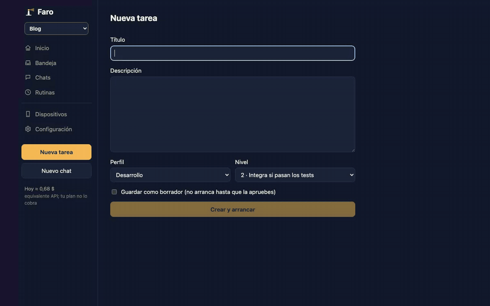

# Faro

[English](README.md)

Faro es un panel de mando que instalas en tu máquina para orquestar agentes de [Claude Code](https://claude.com/claude-code) sobre tus propios repositorios. Describes una tarea desde la web (o desde el móvil), Faro lanza `claude -p` en un worktree de git aislado, pasa tus comprobaciones y te deja el resultado para revisarlo, integrarlo y subirlo. Es gratis, con licencia MIT, y lo adaptas a tus proyectos con un solo archivo de configuración en TypeScript.



## Qué hace

- **Tareas en worktrees de git.** Cada tarea tiene su rama y su worktree, así que varios agentes trabajan a la vez sin pisarse.
- **Niveles de autonomía, por tarea o rutina:**

  | Nivel | Puede hacer solo | Necesita tu aprobación |
  |---|---|---|
  | 1. Solo lectura | Leer el repo y escribir un informe | Cualquier escritura en el repo |
  | 2. Borrador (por defecto) | Escribir en su worktree | Merge, push, publicar versión |
  | 3. Merge automático | Integrar en la rama base si las comprobaciones pasan | Push, publicar versión |
  | 4. Autónomo | Push y lanzar un build | Publicar en tiendas o redes (siempre) |

- **Revisión.** Diff, comprobaciones, aprobar e integrar (fast-forward, o PR con squash al pasar el CI), subir o parar un agente en marcha.
- **Varios proyectos, varios repos.** Cada proyecto es independiente (tareas, rutinas, límite de agentes, gasto, avisos, claves); solo los perfiles son comunes. Un proyecto puede tener varios repos: cada tarea elige en cuáles trabaja y se integran todos juntos o ninguno.
- **Perfiles.** Roles con sus instrucciones, nivel por defecto y tiempo máximo (coordinador, desarrollo, calidad, análisis…). El coordinador divide un objetivo en subtareas.
- **Rutinas.** Tareas periódicas con cron: revisión de bugs, auditoría de dependencias, resumen del estado del proyecto…
- **GitHub (opcional, con `gh`).** Vigila el CI de la rama base y crea una tarea de arreglo cuando falla; integra cada tarea por PR.
- **PWA para el móvil.** Bandeja, nuevas tareas y avisos push (web push con VAPID). Acceso remoto por Tailscale con emparejamiento de dispositivos.
- **Sandbox.** En macOS, los agentes y las comprobaciones corren dentro de `sandbox-exec`, y los comandos peligrosos (`git push`, `gh api`, publicar…) están bloqueados.
- **Métricas y ASO (opcional, para apps móviles).** RevenueCat, PostHog y App Store Connect, y seguimiento de keywords de la App Store.

## Requisitos

- **Mejor en macOS.** El sandbox de los agentes (`sandbox-exec`), el llavero y el arranque automático (`launchd`) son solo de macOS. En Linux Faro funciona sin sandbox y los secretos van en variables de entorno.
- **Node 22 o ≥24.** `better-sqlite3` falla en Node 23. Hay un `.nvmrc`: ejecuta `nvm use` primero.
- **La CLI `claude`** con la sesión iniciada (`claude login`). Los agentes usan tu propia cuenta y tu cuota de Claude.
- `gh` con la sesión iniciada, si usas la integración con GitHub.

## Puesta en marcha

```bash
git clone <url-del-repo> faro && cd faro
nvm use
npm install
cp faro.config.example.ts faro.config.ts   # edítalo: proyectos, perfiles, rutinas
npm run build:web
npm start                                   # http://127.0.0.1:3200
```

Git ignora `faro.config.ts`, así que tus proyectos y prompts no salen de tu máquina. Para guardarlo en otro sitio, usa `FARO_CONFIG=/ruta/a/faro.config.ts`.

Desarrollo: `npm run dev` (servidor) y `npm run dev:web` (web en :5173 con proxy a la API).

Arranque automático en el Mac: `scripts/install-launchd.sh` (usa el Node activo; con otro, `FARO_NODE=/ruta/a/node`). Para pararlo: `launchctl bootout gui/$(id -u)/com.faro.server`.

## Portada y panel de configuración

- **Portada.** La página de inicio resume cada proyecto: un titular, las cifras clave, la salud (CI, último build, versión en la tienda, PR abiertos, rutinas que fallaron) y la actividad de la semana. Cada cifra abre una vista de detalle con su serie diaria y sus desgloses. Sin `metrics`, GitHub ni `release` también funciona y enseña el gasto de Faro, la salud y la semana.
- **Panel de configuración.** Las rutinas, los perfiles, el proyecto y los ajustes generales se editan desde la web. `faro.config.ts` es la semilla: lo que cambias en el panel se guarda en la base de datos y tiene prioridad sobre el archivo, campo a campo, y se aplica sin reiniciar. «Volver a la config» deshace el cambio y recupera el valor del archivo. Los ajustes del servidor (`host`, `port`, `dataDir`, `allowedHosts`, `claudeBin`, `sandbox`…) y el `mcpConfig` de un perfil solo se editan en el archivo, igual que las rutinas que publican en las tiendas.
- **Desde un dispositivo vinculado** (el móvil por Tailscale) solo se cambian rutinas y perfiles hasta nivel 2: nada que ya sea de nivel 3-4, ni el perfil coordinador, ni un perfil que use una rutina de nivel 3-4. El Proyecto y los Generales solo se cambian desde el Mac. Lo comprueba el servidor; la web solo deshabilita los controles.
- **Asistente de rutinas.** Describes una rutina en una frase y Claude redacta el borrador (nombre, horario, perfil, nivel 1-2, contexto, tope de gasto y prompt) para que lo revises antes de guardarlo. Cada llamada lanza `claude` con lo mínimo y un tope de 0,50 $, así que cuesta muy poco pero no es gratis, y va a tu cuenta. Un borrador a la vez y 50 como máximo al día.

## Personalizarlo

Toda tu configuración vive en `faro.config.ts` (mira [`faro.config.example.ts`](faro.config.example.ts)):

| Opción | Para qué sirve |
|---|---|
| `title` | Nombre del panel en la web (por defecto `Faro`). |
| `profiles` | Roles: instrucciones de cada agente, nivel por defecto y tiempo máximo; opcionales `model`, `effort` (`--effort`), `isolation` (`minimal` por defecto: los agentes cargan solo la configuración de Claude del repo, no tus plugins, skills ni CLAUDE.md global; `user` también los carga) y `maxBudgetUsd` (tope de gasto por ejecución: al alcanzarlo, la tarea se bloquea). |
| `coordinatorProfile` | Perfil de los chats y de dividir objetivos en subtareas (por defecto `coordinador`). |
| `projects[].repoPath`, `baseBranch`, `prefix`, `startNumber` | Qué repo, qué rama y cómo se numeran las tareas (`DEM-1`…). |
| `projects[].repos` | En vez de `repoPath`/`baseBranch`/`remote`, una lista de repos (`id`, `name`, `path`, `baseBranch`, `remote` y, por repo, `prepare`, `exclude`, `checks`, `release`). Ver [Varios repos en un proyecto](#varios-repos-en-un-proyecto). |
| `projects[].rootPath`, `copyRootClaudeMd` | Carpeta común de un proyecto multi-repo (los agentes pueden leerla pero no escribir en ella) y si su `CLAUDE.md` se copia a la carpeta de cada tarea (por defecto, no). |
| `projects[].instructions`, `profileNotes` | Instrucciones del proyecto que recibe cada perfil tras las suyas (bajo «Sobre <proyecto>:») y notas que solo recibe un perfil en este proyecto (`{ <idPerfil>: 'texto' }`). Deja los perfiles genéricos y pon aquí lo propio del proyecto. |
| `projects[].maxConcurrentRuns` | Agentes de este proyecto a la vez (por defecto 2). Un proyecto lleno no frena a los demás. |
| `projects[].prepare`, `exclude` | Comandos para cada worktree nuevo (p. ej. enlazar `node_modules`) y rutas que nunca se commitean. |
| `projects[].checks` | Comandos que tiene que pasar una tarea antes de revisión; `whenChanged` limita uno a una carpeta. |
| `projects[].routines` | Tareas periódicas con cron, perfil, nivel y prompt (`{fecha}` es la fecha del día); `maxBudgetUsd` manda sobre el tope del perfil; `repos` limita una rutina multi-repo a algunos repos. |
| `projects[].github` | `ci` vigila el CI, `prs` integra por PR y `ciProfile` elige quién arregla un CI roto. |
| `projects[].metrics` | RevenueCat, App Store Connect y PostHog; `posthogFunnel` define las etapas, filtros y la tarjeta de conversión de tu embudo. |
| `projects[].aso`, `release` | Keywords de la App Store y comandos de build y envío tras integrar (EAS por defecto). |
| `retryWatchdog` | Cuánto sigue reintentando la CLI ante sobrecargas y límites de uso (activado, 5 min como máximo) antes de que Faro pause la cola. |
| `maxConcurrentRuns` | Tope global opcional de agentes entre todos los proyectos. Sin él, cada proyecto solo sigue su propio límite. |
| `host`, `port`, `dataDir`, `allowedHosts`, `sandbox` | Servidor y ejecución. |

El menú solo enseña Métricas y ASO si algún proyecto las usa, y el Plan solo enseña lo de la tienda si el proyecto tiene `release`.

Los secretos nunca van en la config. Puedes darlos de dos formas (la página Métricas muestra el comando exacto de cada uno):

```bash
security add-generic-password -U -s faro -a posthog -w
```

o, en cualquier sistema, como variable de entorno al arrancar Faro (`FARO_SECRET_POSTHOG`, `FARO_SECRET_REVENUECAT`, `FARO_SECRET_ASC_KEY_ID`, `FARO_SECRET_ASC_ISSUER`, `FARO_SECRET_ASC_P8`, `FARO_SECRET_GITHUB_LECTURA`). Faro las quita de su entorno al arrancar para que no las hereden los agentes ni las comprobaciones.

Con varios proyectos, cada clave de métricas (`revenuecat`, `posthog`, `asc-*`) también puede ir por proyecto: cuenta del llavero `<nombre>:<proyecto>` (p. ej. `revenuecat:tienda`) o la variable `FARO_SECRET_<NOMBRE>_<PROYECTO>` (en mayúsculas, `-` y `:` pasan a `_`, p. ej. `FARO_SECRET_REVENUECAT_TIENDA`). Si un proyecto no tiene la suya, usa la general: así los proyectos pueden compartir la clave de App Store Connect o de PostHog y tener cada uno su RevenueCat (la página de Métricas solo propone la cuenta por proyecto para RevenueCat).

## Varios proyectos

Con más de un proyecto aparece un selector en la barra lateral. Toda la web (inicio, bandeja, chats, historial, rutinas, plan, métricas, ASO, gasto) muestra solo el proyecto actual; se recuerda por dispositivo y un enlace puede fijarlo con `?p=<id>`. Al abrir una tarea se cambia a su proyecto. En **Dispositivos**, cada dispositivo emparejado elige de qué proyectos recibe avisos (por defecto, de todos), y el título del aviso lleva el nombre del proyecto.

### Varios repos en un proyecto

Usa `repos` en vez de `repoPath` (mira el proyecto `tienda` comentado en [`faro.config.example.ts`](faro.config.example.ts)). Las tareas comparten numeración y, al crear una, marcas en qué repos trabaja (por defecto, en todos). Entonces:

- La tarea tiene una carpeta `worktreesDir/<rama>/` con un worktree por repo (`<rama>/<idRepo>/`), todos en la misma rama. El agente trabaja en esa carpeta y sabe qué subcarpeta es cada repo.
- `prepare`, `exclude` y `checks` se ejecutan por repo, dentro de su worktree; `whenChanged` es relativo al repo y no se corren las comprobaciones de los repos sin cambios.
- **La integración es atómica**: Faro actualiza primero cada repo con su rama base; si alguno choca, no se fusiona ninguno y se crea una tarea de conflicto solo con los repos que chocan. Dos tareas del mismo proyecto nunca se integran a la vez.
- **El push** va repo a repo y salta los que no tienen nada nuevo. Si uno falla, los demás quedan subidos, el error dice cuál falta y reintentar sube solo lo que queda.
- Faro puede subir la rama base aunque no esté en ningún checkout (p. ej. si tus checkouts están en ramas de feature): fusiona lo nuevo del remoto en un worktree temporal.
- El sandbox protege los repos y worktrees de todos los demás proyectos, y `rootPath` es de solo lectura.
- `release` solo puede ir en un repo; una tarea con lanzamiento debe incluir ese repo.
- Por ahora un proyecto multi-repo no admite `github.prs` ni `github.ci`: las tareas se integran en local tras las comprobaciones de Faro.

## Datos

Todo vive en `~/.faro` (o en tu `dataDir`): `faro.db` (SQLite), `artifacts/`, `worktrees/`, `logs/` y `vapid.json`.

## Pruebas

- `npm test`: suite completa con un `claude` simulado.
- `npm run smoke`: prueba real con la CLI de Claude (gasta un poco de cuota).
- `npm run typecheck`.
- `scripts/demo/gif.sh`: regenera `docs/demo.gif` con un Faro desechable y un agente simulado (necesita ffmpeg y Playwright; mira el script).

## Licencia

[MIT](LICENSE)
